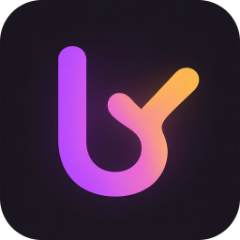
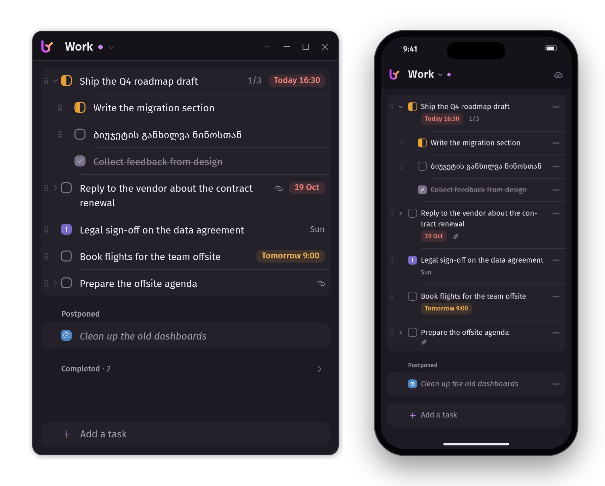
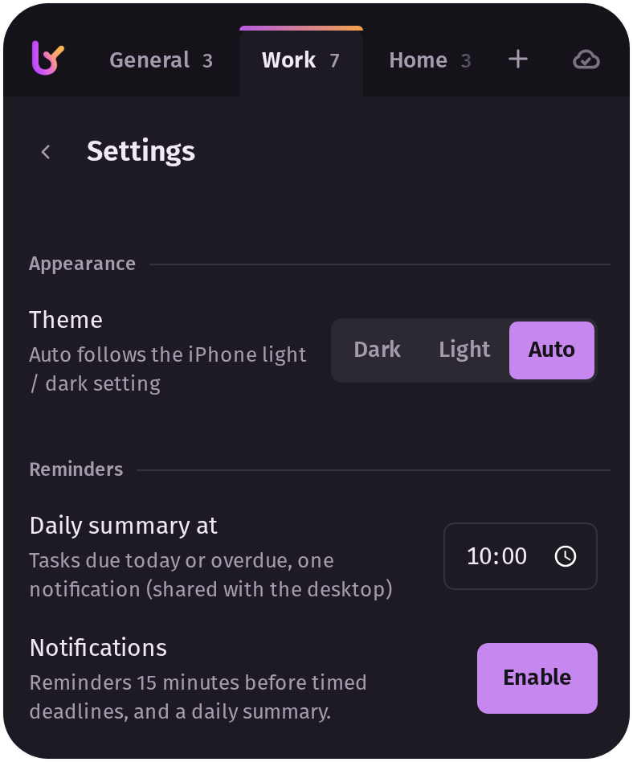

<p align="center">
  
</p>

<h1 align="center">Saqme To Do</h1>

<p align="center">
  Markdown to-do lists you and your AI can edit, on desktop and phone, with optional sync in your own Cloudflare account.
</p>

<p align="center">
  
</p>

## Features

- **Your lists are files.** One markdown file per project (`lists/Work.md`). Edit them in any editor, script
  them, or let an AI assistant rewrite them; the app picks the changes up. [Format](docs/file-format.md).
- **Every platform, one look.** A small widget on Windows, an app window on macOS and Linux, and the phone
  app on iPhone and Android. All work offline and share one design, down to the typeface.
- **No account needed.** Everything works on a single device. Sync is optional: it runs on the free plan of
  your own Cloudflare account, with no subscription and no server run by anyone else.
- **Built for real lists.** Subtasks with progress, seven statuses, deadlines with an optional time (type
  "fri 14:00" or "+3"), notes with links, drag to reorder, move tasks between projects.
- **Reminders.** 15 minutes before a timed deadline and at the time, plus one daily summary of what is due:
  on the computer from the start, on phones once sync is set up.
- **Shared lists.** Share one list with someone (on Windows right-click its tab; on a phone, Linux and macOS
  long-press or right-click its name at the top; then **Share…**): they get a one-time invite
  link, can edit or only view, and you can revoke them at any time. The list stays on your sync service. They
  need no account and not even Saqme: the list works in their browser, and moves into their Saqme app later
  with one link. On their computer it is a markdown file like any other; on their phones it reminds them of
  its deadlines. [How it works](docs/sync.md#shared-lists).
- **Keyboard-first on Windows.** Up/Down move between tasks, Enter adds a task, Shift+Enter a subtask, Tab
  indents while you edit one, Alt+Up/Down moves it.
- **Accessible.** Everything works from the keyboard; screen readers get names, roles and states for every
  control (checked with axe-core and Windows UI Automation); text and status colours meet WCAG 2.2 AA in both
  themes. [What is checked](docs/accessibility.md).

## Get started in one command

**Windows:** paste this into PowerShell (or a Command Prompt).

```powershell
powershell -NoProfile -ExecutionPolicy Bypass -Command "irm https://raw.githubusercontent.com/francuza9/saqme-to-do/main/scripts/setup.ps1 | iex"
```

**macOS and Linux:** paste this into a terminal.

```bash
curl -fsSL https://raw.githubusercontent.com/francuza9/saqme-to-do/main/scripts/setup.sh | bash
```

Setup installs the app with your lists on this computer; no account is needed. To have them on your phone
too, open the app's **Settings > Sync & sharing** and choose **Set up sync**. It creates your own free sync service in your Cloudflare account and uploads your lists (nothing is
deleted). The one step it cannot do for you is the Cloudflare login: a browser window opens, you sign in (or
create a free account) and click **Allow**. Then the app shows a QR code for your phone. From then on the app
updates itself, your sync service and the phone app with it (**Settings > Updates**); running setup again is
still safe at any time and repairs the app.

| | Without an account | With sync |
|---|---|---|
| **Windows** | desktop widget, lists in a folder | the same lists on your phones and other computers |
| **macOS, Linux** | app window, lists in a folder, reminders | the same |
| **iPhone, Android** | the phone app, lists on the phone (export and import as markdown) | pair it with the QR code |

Prefer to look first? Download the repository as a ZIP and run **`setup.cmd`** (Windows) or
`scripts/setup.sh`. Every step, requirement and manual click is in [docs/setup.md](docs/setup.md).

<details>
<summary>Setup options</summary>

| Windows | macOS, Linux | What it does |
|---|---|---|
| (default) | (default) | only the app; your lists stay on this computer |
| `-Cloud` | `--cloud` | the app and the cloud part (what *Set up sync* in the app's Settings does; also updates it) |
| `-CloudOnly` | `--cloud-only` | only the cloud part |
| `-RotateToken` | `--rotate-token` | a new access key: the old one stops working at once (pair your devices again) |
| `-DeviceLogin` | `--device-login` | log in to Cloudflare with a code instead of a browser redirect |
| `-NoStart`, `-NoAutostart` | `--no-start`, `--no-autostart` | don't start the app / don't start it at login |
| `-Uninstall [-PurgeData]` | `--uninstall [--purge-data]` | remove the app (your lists stay unless you add the second option) |

</details>

## Your phone in 3 steps

1. **Scan the QR code** the computer app shows after setting up sync with the phone camera, and open the
   link (Safari on iPhone, Chrome on Android). To see it again: **Settings > Sync & sharing > Pair phone**
   (Linux and macOS: **Pair a phone**).
2. **Add it to the Home Screen:** on iPhone tap **Share**, then **Add to Home Screen**; on Android, **Install app**.
   On iPhone, open Saqme from the Home Screen and type the **pairing code** shown under the QR code (and in
   Safari after step 1): iOS gives Home Screen apps storage of their own, so the app starts unpaired.
3. **Turn on reminders:** in Saqme on the Home Screen, tap the logo to open **Settings**, then
   **Notifications**, and switch **Notifications** on (iOS 16.4 or later).

<p align="center">
  
</p>

Your lists are already there, and they stay available offline. No Cloudflare account? The phone app also
works on its own, with the lists kept on the phone: open <https://francuza9.github.io/saqme-to-do/> and tap
**Use it on this device** ([details](docs/setup.md#7-phones-and-browsers-without-a-cloud-account)).

## How sync works

Every change is saved on the device first and sent in the background to a small Worker with a D1 database
in your Cloudflare account, which passes it on to your other devices. Changes merge per task and per field,
so renaming a task on the phone while ticking it off on the PC keeps both. If the same field changes on two
devices before they sync, the newest edit wins and the other one waits under **Conflicts** for you to pick;
deleted tasks go to **Recently deleted**. On a computer, the lists folder is part of this: a file edited by
hand or by an AI assistant syncs like any other change. The details are in [docs/sync.md](docs/sync.md).

## Privacy

Your lists are stored on your devices and, if you turn sync on, in the database of your own Cloudflare
account. Nobody else runs a server for this app, and it has no analytics or tracking. Without sync, nothing
leaves the device. With it, devices prove access with a 256-bit key that travels in the pairing link after
the `#`, the part of a URL browsers never send to a server (the app removes it from the address bar at once).
A pairing code is a short stand-in for that link: it works once, for 10 minutes, and only a device that
already has the key can ask for one. A list you share gives the other person a key of their own for that one
list, which you can revoke; their changes to it are stored on your service, and they see nothing else of yours.
Cloudflare hosts the data (encrypted at rest);
the key is stored on your devices (the app's data folder and the phone app's storage), so protect them as
you would any signed-in device. On macOS and Linux the app window talks to a local program that answers
only on this computer and only with its own key.

The copy of the phone app on GitHub Pages (for use without a Cloudflare account) is shared: everyone who
uses it runs the code published there. If you would rather not trust that, use the copy your own sync
service serves (with sync, the QR code opens exactly that) or host your own (fork the repository and enable
Pages).

## FAQ

**Does it cost anything?** No. Without sync there is nothing to pay for. Sync fits Cloudflare's free plan
with a wide margin: a typical day is under 10,000 requests against 100,000 allowed, and the database stays
in the megabytes against 5 GB.

**Do I need a Cloudflare account?** Only for sync. Each app works on its own, and the phone app can export
and import its lists as markdown files.

**What happens offline?** Everything keeps working. Changes queue up and are sent when the connection is
back.

**Can my AI assistant edit the lists?** Yes, that is the point. Each line carries a short id like
`^k3j9x2ab` so sync can follow a task through edits; leave it in place (the app usually re-attaches a lost
one). See [docs/file-format.md](docs/file-format.md).

**Can I share a list with someone?** Yes. They need the app, not a Cloudflare account; you need sync (the list
stays on your sync service). Each invite works once, for 24 hours; you pick *can edit* or *can view* and can
change or revoke it later. What they change goes to your service only. [Steps](docs/setup.md#9-sharing-a-list-with-someone).

**How do I update it?** You don't need to do anything: the app checks GitHub for a new release about once a
day and installs it when it is idle (or now, with **Settings > Updates > Update now**). It checks the download
against the release's checksum, keeps the version before to go back to, updates your own Worker (its keys
and data stay) and never touches your lists; the phone app follows by itself. If Cloudflare's sign-in has
expired, the app asks you to sign in again with one click. An install from before 1.1.0 needs setup run once
more to get the updater. [Details](docs/setup.md#updating).

**Android?** Yes: the phone app installs from Chrome, push included. It is tuned and tested mostly on iPhone.

**Which Linux and macOS versions?** Linux with glibc 2.28 or newer (Debian 10, Ubuntu 20.04, RHEL 8, Fedora
and anything newer) and macOS 13.5 or newer; older systems work with Node.js 22.13+ installed.
[Details](docs/setup.md#requirements-linux-and-macos).

**No notifications on Windows?** Check Do Not Disturb, and make Saqme To Do a priority app under Windows
notification settings. More in [docs/setup.md](docs/setup.md#windows-notifications).

## Documentation

- [docs/setup.md](docs/setup.md): every setup step, updating, troubleshooting, removing everything
- [docs/sync.md](docs/sync.md): the sync protocol and conflict rules
- [docs/file-format.md](docs/file-format.md): the markdown format and the data folder
- [docs/architecture.md](docs/architecture.md): how the pieces fit together
- [docs/design.md](docs/design.md): colours, type and layout shared by all the apps
- [docs/accessibility.md](docs/accessibility.md): keyboard, screen readers, contrast, and how they are checked
- [docs/testing-shared-lists.md](docs/testing-shared-lists.md): trying shared lists by hand with a second person
- [CONTRIBUTING.md](CONTRIBUTING.md): running the tests and the apps locally

## License

MIT, see [LICENSE](LICENSE). The bundled typeface is [FiraGO](https://github.com/bBoxType/FiraGO) by Carrois / bBox Type and HERE,
under the SIL Open Font License 1.1 ([worker/public/fonts/OFL.txt](worker/public/fonts/OFL.txt)).
